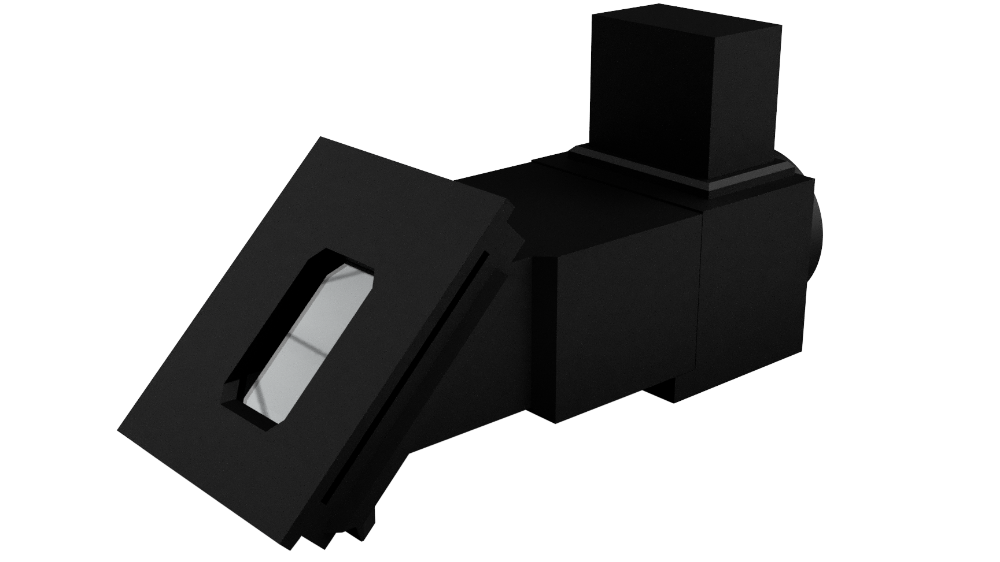
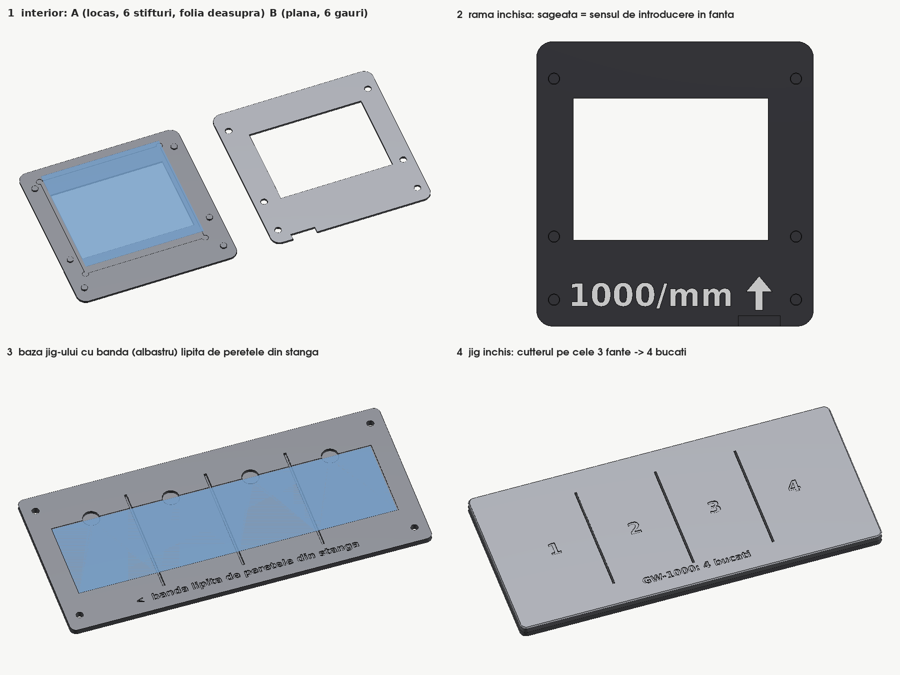

# Smartspectrometer — Double-Beam Spectrophotometer

A low-cost, open-source, 3D-printable double-beam spectrophotometer for students and teachers.

Device designed by **Winters et al. (2021)**. Assembly and use manual developed by **GeoEduLab · INFP** (National Institute for Earth Physics, Romania).



---

## Manuals

| | Română | English |
|---|--------|---------|
| **Markdown** | [Smartspectrometer-Manual-RO.md](Smartspectrometer-Manual-RO.md) | [Smartspectrometer-Manual-EN.md](Smartspectrometer-Manual-EN.md) |
| **PDF** | [Smartspectrometer-Manual-RO.pdf](Smartspectrometer-Manual-RO.pdf) | [Smartspectrometer-Manual-EN.pdf](Smartspectrometer-Manual-EN.pdf) |

---

## Instruction Video

A short video presentation of the assembly process: [Spectrometrul Printat 3D Asamblare](https://youtu.be/sLuob3aO6XI)

---

## What's in this repo

```
imagini/                 Component photos and assembly diagrams
new_parts/slits/         Slit cards 0.25 / 0.5 / 1 mm + 12-width test card (STL, 3MF)
new_parts/grating_frame/ Frame for the diffraction film + jig that cuts the strip in 4 (STL, 3MF)
pdf-style.css            CSS stylesheet for PDF generation
md-to-pdf.config.json    md-to-pdf settings for the PDF manuals
```

The original parts (DBS01-DBS25) are at https://osf.io/7ewb3.

---

## New parts (GeoEduLab, 2026)

Printed slit cards and a frame for the grating film, with a cutting jig, that fit the original DBS02 and DBS03.
Details, print settings and instructions: [new_parts/README.md](new_parts/README.md).



---

## About the instrument

The spectrophotometer costs **≈€25** in parts and uses a **smartphone** as detector. It can perform:

- **Emission spectroscopy** — identify light sources (bulbs, LEDs, flames)
- **Absorption spectroscopy** — measure chlorophyll, colored solutions, Beer-Lambert law
- **Calibration** — using a red laser pointer or fluorescent bulb lines

---

## Reference

Winters, B.J., Banfield, N., Dixon, C., Swensen, A., Holman, D., & Fillbrown, B. (2021).
*3D-Printable and open-source modular smartphone visible spectrophotometer.*
HardwareX, 10, e00232. https://doi.org/10.1016/j.ohx.2021.e00232

STL files and full documentation: https://osf.io/7ewb3

---

**Hardware license:** CC BY-SA 4.0 · **Manual license:** CC BY-SA 4.0
