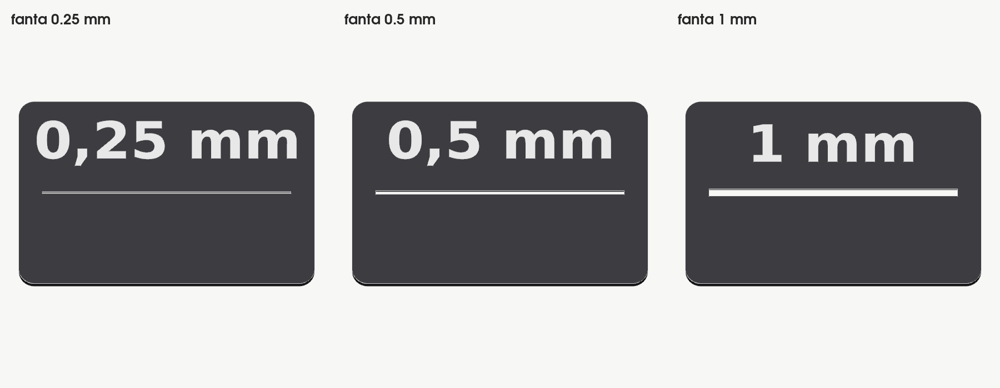
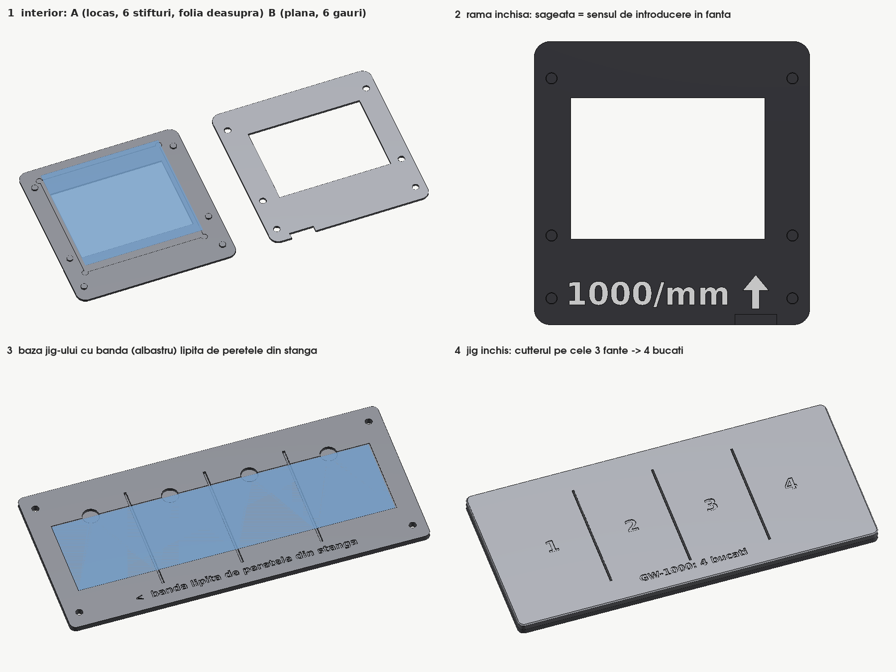

# New parts by GeoEduLab · INFP

Three printed parts we added to the Winters et al. (2021) spectrophotometer: interchangeable **slit cards**, a **frame for
the diffraction grating film** and a **jig** that cuts the film strip into four equal pieces. They fit the original DBS02
and DBS03 without any change to those parts. Romanian version below.

All files were sliced for a Bambu Lab H2S (0.4 mm nozzle, 0.16 mm Standard, PETG HF). The `*_H2S.3mf` files are ready-to-print
Bambu Studio projects; the generic `.3mf` and `.stl` files work in any slicer. The white lettering is a separate part that
fills the engraving, so it prints in two colours with an AMS (or in one colour if you skip it).

## Slit cards (`slits/`)

Three cards with a 32 mm long slit of **0.25, 0.5 and 1.0 mm**, the width engraved on each. They let students see how the slit
width changes the spectrum: a narrow slit gives thinner lines (better resolution) but lets less light through.

| file | content | print time / material |
|---|---|---|
| `Fante_v0.5_H2S.3mf` | the 3 cards, black + white lettering | 0.21 h / 4.5 g |
| `Fante_proba12_v0.5_H2S.3mf` | test card with 12 widths, 0.05 ... 1.2 mm | 0.69 h / 14.7 g |
| `Fante_0.25_0.5_1.3mf`, `proba_latimi.3mf` | the same, generic 3MF | |
| `fanta_<w>.stl` + `fanta_<w>_text.stl` | card body + white lettering, w = 0.25 / 0.5 / 1 | |

- Card 38 x 25 x 1.0 mm, rounded corners R2, with the outline of the `SlitFinal.stl` card from the OSF archive; it goes in the slit slot of
  DBS02 instead of the blade assembly DBS22/DBS23. In the STL assembly it clears every part and sits 0.45 mm below the rim of
  DBS02; turn DBS02 over to take it out.
- **Why these widths:** we sliced 12 widths and measured the gap left in the G-code. The slicer closes a 0.05 mm slit
  completely (0.4 mm nozzle); from 0.1 mm up the gap in the G-code equals the drawn width. On the printed part the gap comes
  out somewhat narrower and below ~0.2 mm the edges may fuse, so the narrowest card is 0.25 mm and each next one doubles.
- Print the 12-width test card first if you want to know what your printer actually opens: hold it against a lamp and keep
  the widths that are open along the whole length.

## Grating frame and cutting jig (`grating_frame/`)

Replaces the cardboard frames of the AstroMedia GW-1000 film (1000 lines/mm). The film strip (153 x 39 mm, 0.05 mm thick,
measured) is cut into four pieces with the jig; each piece is clamped between two printed halves.

| file | content | print time / material |
|---|---|---|
| `RamaRetea_4rame_v1.5_H2S.3mf` | 4 frames = 4 x half A + 4 x half B, black + white lettering | 0.66 h / 12.8 g |
| `RamaRetea_jig_v1.5_H2S.3mf` | jig: base + lid | 1.94 h / 74.7 g |
| `RamaRetea_4rame_v1.5.3mf`, `RamaRetea_jig_v1.5.3mf` | the same, generic 3MF | |
| `rama_A.stl`, `rama_B.stl`, `rama_B_text.stl` | frame halves (B with the white "1000/mm" and arrow) | |
| `jig_baza.stl`, `jig_capac.stl` | jig base and lid | |

**Cutting the strip**
1. Lay the strip in the pocket of the jig base and push it against the left wall (engraved arrow). Touch the film only at
   its edges.
2. Put the lid on: the 4 pins go into the holes of the base and the numbers 1-4 must read the right way.
3. Run a cutter through each of the 3 slots; the blade drops into a channel in the base and cuts the film through.
4. Lift the pieces with tweezers from the round notches. Each piece is 38.25 x 39 mm (cuts at 38.25 / 76.5 / 114.75 mm
   from the wall; a 152 mm strip gives a last piece 1 mm shorter).

**Assembling a frame**
- Half A has a pocket for the piece (39.6 x 39.05 x 0.16 mm) and 6 pins; half B is flat, with 6 holes and the white
  lettering. Lay the piece in the pocket, press B onto A with the lettering outwards: the pins press-fit, no glue.
  A notch at the outer end lets you open the frame again.
- Frame 52.6 x 54.05 mm, about 1.36 mm thick as printed; window 37 x 27 mm, centred on the opening of DBS03.
- **Insert it into the side slot of DBS03 with the arrow tip first**; the end with the notch stays ~2 mm outside.
- The pocket accepts the piece in both orientations, so **check at a lamp before use**: the grating lines must be horizontal
  in DBS03 (manual, step 2d). If the spectrum comes out wrong, open the frame and turn the piece by 90 degrees.

All dimensions were measured on the OSF STL files, not on printed parts. The slot of a printed DBS03 can be slightly narrower
than the 1.52 mm in the STL; print one frame first and check the fit.

## Licence and credit

These parts are adapted to the DBS spectrophotometer of Winters et al. (2021), HardwareX 10, e00232
(https://doi.org/10.1016/j.ohx.2021.e00232, files at https://osf.io/7ewb3), and are released, like the original hardware,
under **CC BY-SA 4.0**. Design: GeoEduLab · INFP (National Institute for Earth Physics, Romania), 2026.

---

# Piese noi GeoEduLab · INFP (RO)

Trei piese tiparite adaugate spectrofotometrului Winters et al. (2021): **cartonase cu fanta** interschimbabile, o **rama
pentru folia retelei de difractie** si un **jig** care taie banda de folie in patru bucati egale. Intra in DBS02 si DBS03
originale, fara modificari.

Fisierele `*_H2S.3mf` sunt proiecte Bambu Studio gata de tiparit (H2S, duza 0,4, 0,16 Standard, PETG HF); `.3mf` generice si
`.stl` merg in orice slicer. Scrisul alb e o piesa separata care umple gravura (doua culori cu AMS).

**Fante (`slits/`):** 0,25 / 0,5 / 1,0 mm, latimea gravata pe fiecare; cartonas 38 x 25 x 1,0 mm cu conturul lui `SlitFinal.stl` din arhiva OSF,
in locasul fantei din DBS02 (in locul lamelor DBS22/DBS23). Slicer-ul inchide fanta de 0,05 mm; de la 0,1 mm golul din G-code
e cel desenat, dar pe piesa iese mai ingust, de aceea cea mai ingusta e 0,25. Cartonasul de proba are 12 latimi
(0,05 ... 1,2 mm): il tii in fata unui bec si pastrezi latimile deschise pe toata lungimea.

**Rama si jig-ul (`grating_frame/`):** inlocuiesc ramele de carton ale foliei AstroMedia GW-1000 (1000 linii/mm).
1. Pui banda (153 x 39 mm) in buzunarul bazei jig-ului, lipita de peretele din stanga; o tii doar de margini.
2. Pui capacul: cele 4 stifturi intra in gauri, cifrele 1-4 se citesc corect.
3. Tragi cutterul prin cele 3 fante; lama coboara in canalul din baza.
4. Ridici bucatile (38,25 x 39 mm) cu penseta din crestaturi.

Bucata intra in locasul din jumatatea A; apesi B peste A cu scrisul in afara (stifturi presate, fara lipici). Rama intra in
fanta laterala a lui DBS03 **cu varful sagetii inainte**; capatul cu crestatura ramane ~2 mm afara. Verifica la un bec:
liniile retelei trebuie sa fie orizontale in DBS03 (manual, pasul 2d); altfel rotesti bucata cu 90 de grade.

Licenta: **CC BY-SA 4.0**, ca hardware-ul original (Winters et al., 2021, https://osf.io/7ewb3). Proiectare: GeoEduLab · INFP, 2026.
